# Xurcroh

**Private AI inference, without trusting any single machine.**

Xurcroh is a production-accepted distributed inference platform for dense and Mixture-of-Experts language models, vision-language models, image generation, and video generation. Its Fortress engine splits models and activations into exact integer shares across independent GPU workers, keeps prompts and decoded outputs on the client, verifies every result, and protects every connection with hybrid post-quantum sessions.

Run anything from compact open models to frontier-scale mixtures of experts across commodity GPUs, confidential VMs, or a mixture of providers — through one familiar Python API.

## Deploy on your cloud

Build a private inference grid across independent commodity GPUs or hardware-attested confidential VMs. Xurcroh uses the same Python SDK on every platform: it discovers worker resources, distributes sealed model shares, establishes post-quantum sessions, verifies results, and cleans up the deployment. Start with a single provider or combine independent providers for stronger failure-domain separation.

<p>
<a href="docs/deployment/vast.md"></a>
<a href="docs/deployment/runpod.md"></a>
<a href="docs/deployment/azure-tee.md"></a>
<a href="docs/deployment/gcp-tee.md"></a>
</p>

- **[Vast.ai](docs/deployment/vast.md):** automated offer selection, budget-guarded lifecycle, CUDA deployment over SSH, and verified teardown for independent GPU hosts.
- **[RunPod](docs/deployment/runpod.md):** SDK-managed Fortress workers on GPU pods, with tunneled transport when direct QUIC is unavailable.
- **[Microsoft Azure](docs/deployment/azure-tee.md):** NCC40ads H100 v5 confidential VMs with CPU/GPU attestation, scoped networking, and managed resource cleanup.
- **[Google Cloud](docs/deployment/gcp-tee.md):** A3 HighGPU workers with Intel TDX, NVIDIA attestation, Shielded VM features, and managed firewall cleanup.

See the [platform deployment overview](docs/deployment/providers.md) for prerequisites, topology planning, security modes, and production acceptance scope. Provider availability, pricing, and quota must be checked at deployment time.

## Validated in production conditions

The complete **L0–L6 text ladder and M1–M4 media ladder passed on physical GPUs across independent hosts**. The validated build is `3b48e2a + patches-01…23` (frozen content hash `7f31c2e0`). Production acceptance applies to that build and the documented deployment conditions.

| Evidence | Result |
|---|---|
| Distributed numerical correctness | **Zero maximum absolute error** against the Fortress quantized reference on every ladder rung |
| Security attack suites | **34/34 checks passed per rung**, including worker compromise, tampering, replay, and transport attacks |
| Result verification | **Zero Freivalds failures** across the complete validation program |
| Confidential computing | **AMD SEV-SNP, Intel TDX, and NVIDIA GPU attestation** validated on Azure, Google Cloud, and Alibaba Cloud |
| Model coverage | Dense, MoE, VLM, image, and video workflows through Gemma 4, Qwen, Mistral, GLM, Kimi, FLUX.2, Wan 2.2, LTX, and MiniMax H3 |
| Evidence trail | Signed **Ed25519 + ML-DSA-65** rung chain and independently verifiable per-request task traces |
| Validation history | [Full hardware report](docs/xurcroh-validation-report.md) · [Test history](docs/test-history.md) |

Every completed request produces a signed task trace that can be checked with `xurcroh verify` or in a browser on the manual's Verify page; see `docs/task-trace.md` and `docs/claims.md`.

> **Security model:** Xurcroh combines additive secret sharing, client-owned boundaries, encrypted artifacts, authenticated transport, result verification, memory scrubbing, and optional hardware attestation. Confidentiality assumes the documented non-collusion threshold. TEEs add a layer of protection rather than unconditional trust; external audit, second-party reproducibility, and open red-team work remain ongoing assurance activities. See `docs/security.md` for the precise threat model.


<!-- animations:start -->
## See it run

These are recordings of the interactive manual in `apps/web-manual`. They show a simulation that runs in the reader's browser, not the production engine: the questions and answers are prepared, the models are toys, the three relays stand in for a Tor circuit, and the enclaves are simulated. What is computed for real in the page is the share arithmetic, the three layers of AES-GCM, the signature check on each worker's report and the check on each result. The pace is set for viewing and measures nothing.

There are 53 recordings (73 MB together), made frame by frame with `npm run record` in `apps/web-manual`. In the manual itself every one of these views is interactive.

<p align="center">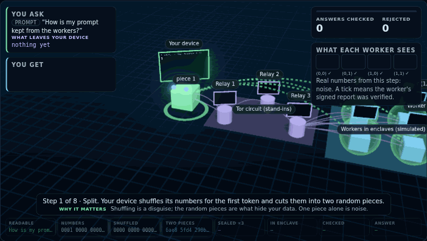</p>

**Text: a prepared question to its answer.** All eight steps once, slowly, then the rest of the answer token by token. From `/show`.

### The pipeline

A question goes in on the left and the answer comes out on the right. In between it is shuffled, split into random pieces, sealed in three layers, passed through three relays, computed by four workers in enclaves, checked and put back together.

<table>
<tr>
<td width="50%" valign="top">
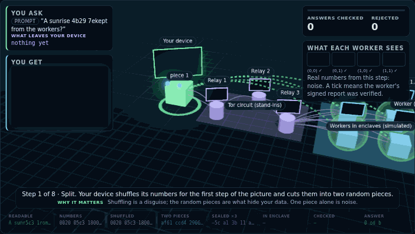<br>
<b>Picture</b><br>
A prepared picture forms step by step on your device; the workers' screens show the noise each of them holds.<br>
<sub>From <code>/show</code></sub>
</td>
<td width="50%" valign="top">
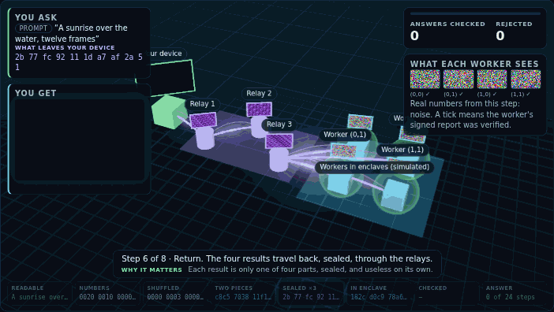<br>
<b>Clip</b><br>
Twelve frames of a short clip, two steps per frame, then the finished clip playing.<br>
<sub>From <code>/show</code></sub>
</td>
</tr>
<tr>
<td width="50%" valign="top">
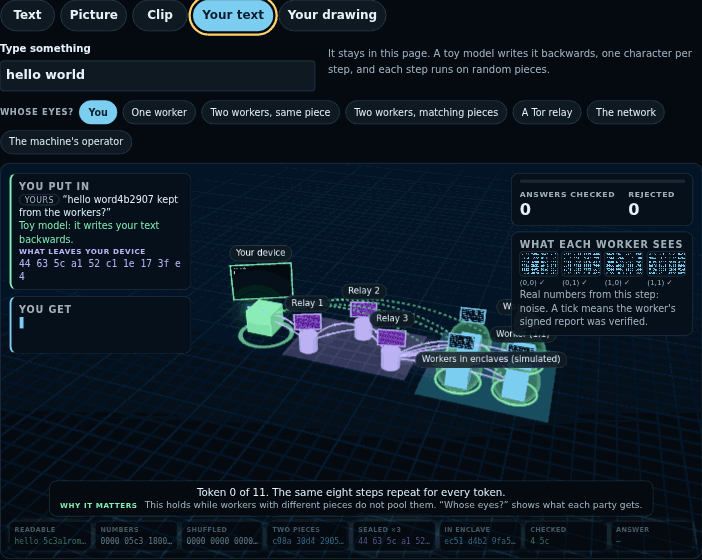<br>
<b>Your text</b><br>
Text typed by the reader; a toy model writes it backwards, one character per step, on random pieces.<br>
<sub>From <code>/show</code></sub>
</td>
<td width="50%" valign="top">
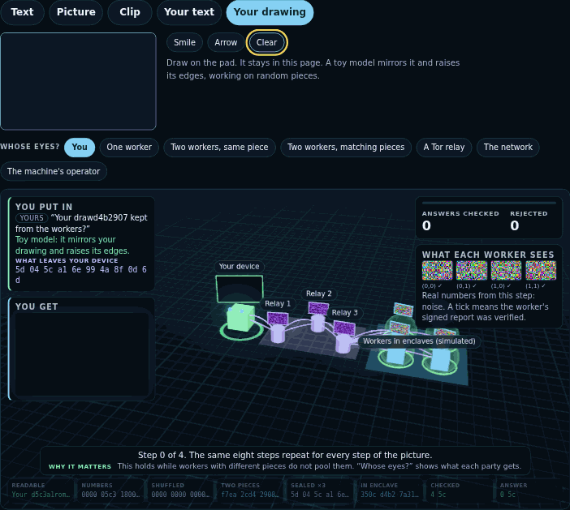<br>
<b>Your drawing</b><br>
A drawing made on the pad is mirrored and embossed by a toy model; then the ready-made drawings.<br>
<sub>From <code>/show</code></sub>
</td>
</tr>
<tr>
<td width="50%" valign="top">
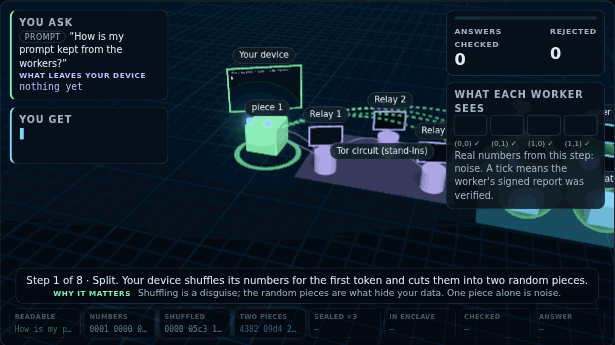<br>
<b>Chapter size</b><br>
The same pipeline as it appears inside chapters 5 and 7 (the first seconds of a run).<br>
<sub>From <code>/05-system-architecture</code></sub>
</td>
<td width="50%" valign="top">
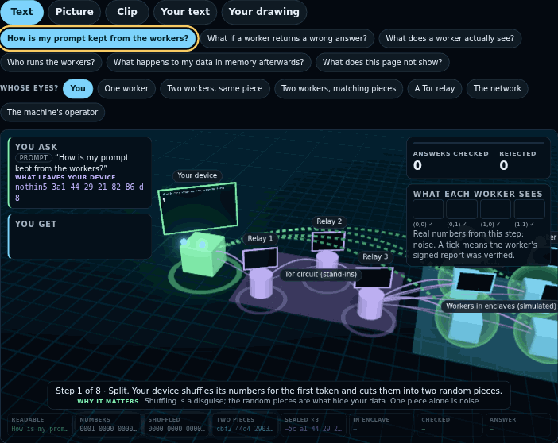<br>
<b>Prepared prompts and pictures</b><br>
The six prepared questions and the two prepared pictures, chosen one after another.<br>
<sub>From <code>/show</code></sub>
</td>
</tr>
<tr>
<td width="50%" valign="top">
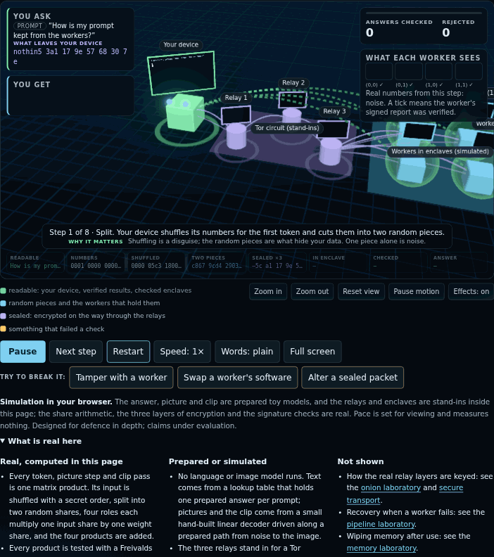<br>
<b>Pause, step, speed, restart</b><br>
The playback controls; then the panel that lists what is real and what is prepared is closed and opened (only its first lines are in the picture).<br>
<sub>From <code>/show</code></sub>
</td>
<td width="50%" valign="top">
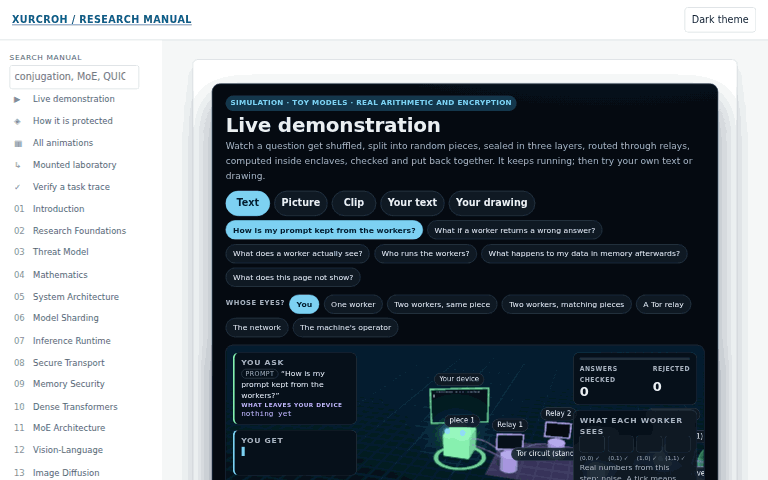<br>
<b>Full screen</b><br>
The demonstration filling the window.<br>
<sub>From <code>/show</code></sub>
</td>
</tr>
</table>

### The pipeline through someone else's eyes

“Whose eyes?” rebuilds the view of another party from what that party really holds.

<table>
<tr>
<td width="50%" valign="top">
<br>
<b>One worker</b><br>
One worker's view: one piece of your data and one piece of the model. Noise.<br>
<sub>From <code>/show</code></sub>
</td>
<td width="50%" valign="top">
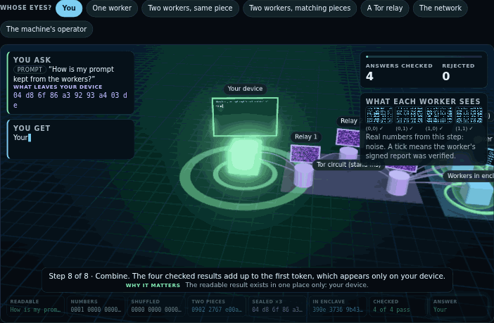<br>
<b>Two workers, same piece</b><br>
Two workers that hold the same piece of your data, pooling what they have. Still noise.<br>
<sub>From <code>/show</code></sub>
</td>
</tr>
<tr>
<td width="50%" valign="top">
<br>
<b>Two workers, matching pieces</b><br>
Two workers that hold both pieces rebuild what you see. This is where the design stops: it relies on such workers not pooling what they hold.<br>
<sub>From <code>/show</code></sub>
</td>
<td width="50%" valign="top">
<br>
<b>A Tor relay</b><br>
The middle relay's view: sealed bytes and the next stop.<br>
<sub>From <code>/show</code></sub>
</td>
</tr>
<tr>
<td width="50%" valign="top">
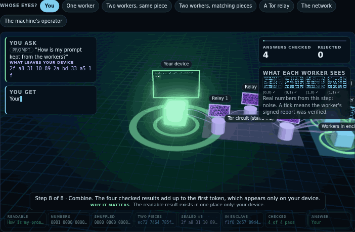<br>
<b>The network</b><br>
Someone watching the network sees encrypted bytes: how much and when, not what.<br>
<sub>From <code>/show</code></sub>
</td>
<td width="50%" valign="top">
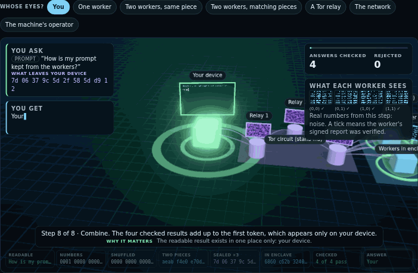<br>
<b>The machine's operator</b><br>
The operator of the machine sees an enclave it cannot look into (simulated here; one more layer, not proof).<br>
<sub>From <code>/show</code></sub>
</td>
</tr>
</table>

### Trying to break the pipeline

Each attack is caught by the real check, and the step is done again.

<table>
<tr>
<td width="50%" valign="top">
<br>
<b>Tamper with a worker</b><br>
One worker's result is changed by one. The check rejects it and the step is done again.<br>
<sub>From <code>/show</code></sub>
</td>
<td width="50%" valign="top">
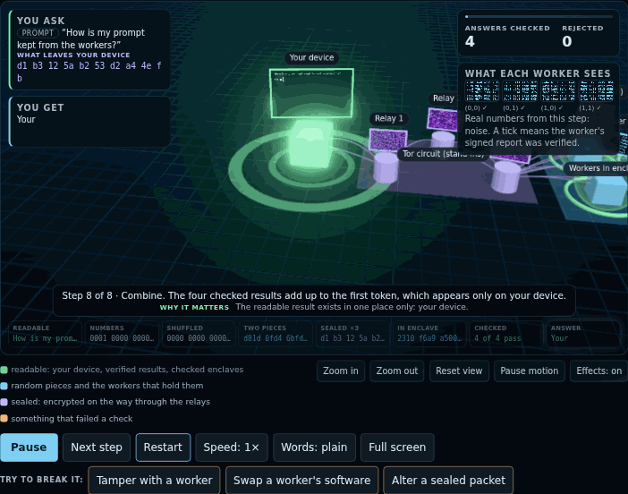<br>
<b>Swap a worker's software</b><br>
A worker's signed report no longer matches the expected software. Nothing is sent to it.<br>
<sub>From <code>/show</code></sub>
</td>
</tr>
<tr>
<td width="50%" valign="top">
<br>
<b>Alter a sealed packet</b><br>
One bit of a sealed packet is flipped. The relay's authenticity check fails and the packet is dropped.<br>
<sub>From <code>/show</code></sub>
</td>
<td width="50%"></td>
</tr>
</table>

### How hard it is to undo

Facts the page computes about recovering what was hidden, each with the place where it stops. No ratings and no adjectives.

<table>
<tr>
<td width="50%" valign="top">
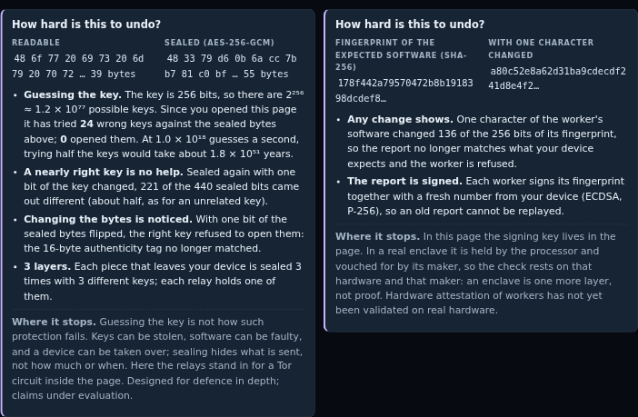<br>
<b>How hard is this to undo?</b><br>
Under the demonstration: readable bytes beside sealed ones, wrong keys the page really tries against them (none opens), what one changed bit does, and where each of these facts stops.<br>
<sub>From <code>/show</code></sub>
</td>
<td width="50%"></td>
</tr>
</table>

### The eleven laboratories

Each laboratory runs one real computation from what goes in to what comes out. The cards along the bottom are its steps, each with the actual values of that step; the lit part of the 3D scene carries the same values; the output panel stays empty until the last step is done, and then the answer is written one token at a time.

<table>
<tr>
<td width="50%" valign="top">
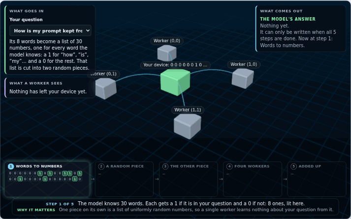<br>
<b>Splitting your question</b><br>
Your question becomes numbers, cut into two random pieces; four workers each work on one piece. The cards along the bottom show the real values of each step; the answer is written only after the last one.<br>
<sub>From <code>/laboratory#share-grid</code></sub>
</td>
<td width="50%" valign="top">
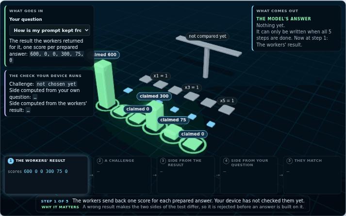<br>
<b>Catching a wrong answer</b><br>
Every result a worker returns is tested against a random challenge before it is used. The cards along the bottom show the real values of each step; the answer is written only after the last one.<br>
<sub>From <code>/laboratory#freivalds</code></sub>
</td>
</tr>
<tr>
<td width="50%" valign="top">
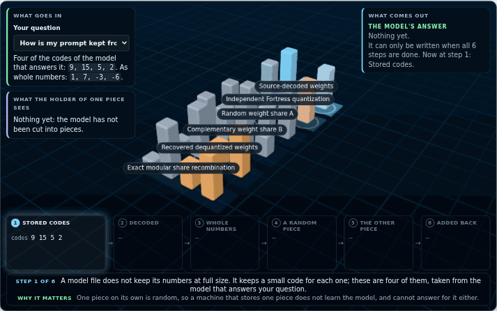<br>
<b>Storing the model in pieces</b><br>
The model's compressed numbers are decoded exactly and split into pieces as well. The cards along the bottom show the real values of each step; the answer is written only after the last one.<br>
<sub>From <code>/laboratory#quantized-formats</code></sub>
</td>
<td width="50%" valign="top">
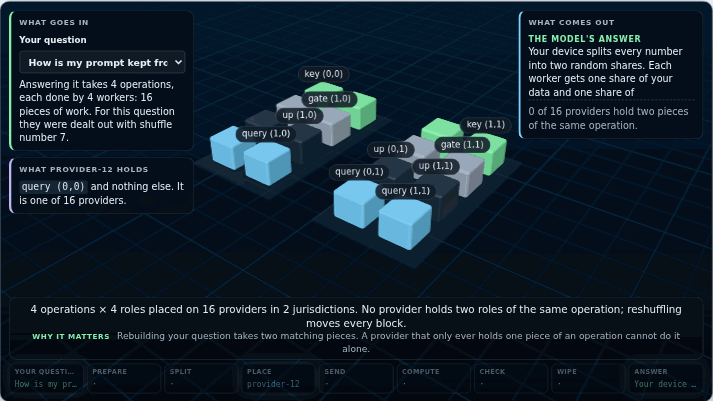<br>
<b>Deciding who gets which piece</b><br>
Pieces that fit together are placed with different providers in different countries. The cards along the bottom show the real values of each step; the answer is written only after the last one.<br>
<sub>From <code>/laboratory#placement</code></sub>
</td>
</tr>
<tr>
<td width="50%" valign="top">
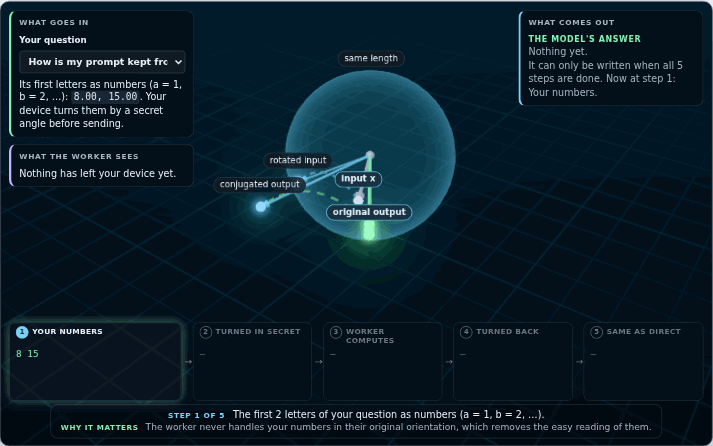<br>
<b>Disguising the numbers</b><br>
The numbers are rotated with a secret rotation before they leave. A disguise, not encryption. The cards along the bottom show the real values of each step; the answer is written only after the last one.<br>
<sub>From <code>/laboratory#conjugation</code></sub>
</td>
<td width="50%" valign="top">
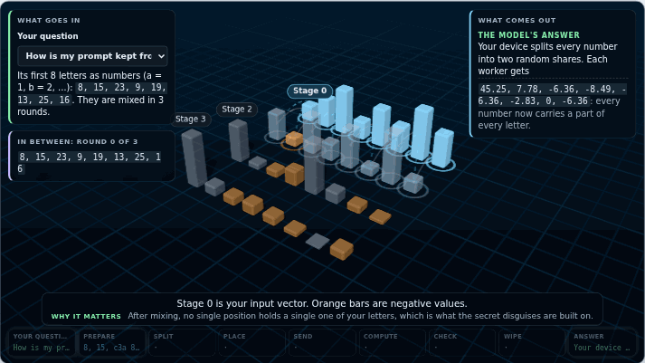<br>
<b>Mixing the numbers quickly</b><br>
A fast mixing transform spreads every number across all the others. The cards along the bottom show the real values of each step; the answer is written only after the last one.<br>
<sub>From <code>/laboratory#fwht</code></sub>
</td>
</tr>
<tr>
<td width="50%" valign="top">
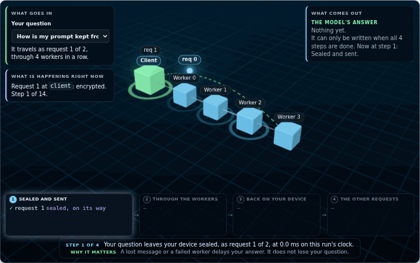<br>
<b>Getting your answer when a worker fails</b><br>
Requests pass from worker to worker; a failed worker is noticed and the work is sent again. The cards along the bottom show the real values of each step; the answer is written only after the last one.<br>
<sub>From <code>/laboratory#pipeline</code></sub>
</td>
<td width="50%" valign="top">
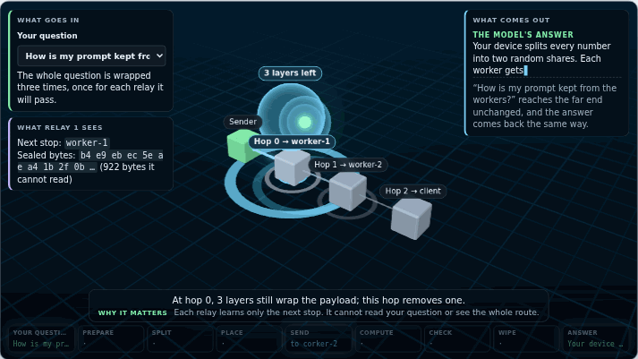<br>
<b>Hiding the route</b><br>
The message is wrapped in layers; each relay removes one and learns only the next stop. The cards along the bottom show the real values of each step; the answer is written only after the last one.<br>
<sub>From <code>/laboratory#onion</code></sub>
</td>
</tr>
<tr>
<td width="50%" valign="top">
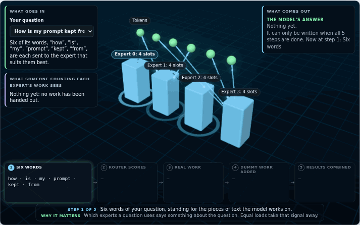<br>
<b>Hiding which experts were used</b><br>
Every expert receives the same amount of work, so the load does not reveal the question. The cards along the bottom show the real values of each step; the answer is written only after the last one.<br>
<sub>From <code>/laboratory#moe</code></sub>
</td>
<td width="50%" valign="top">
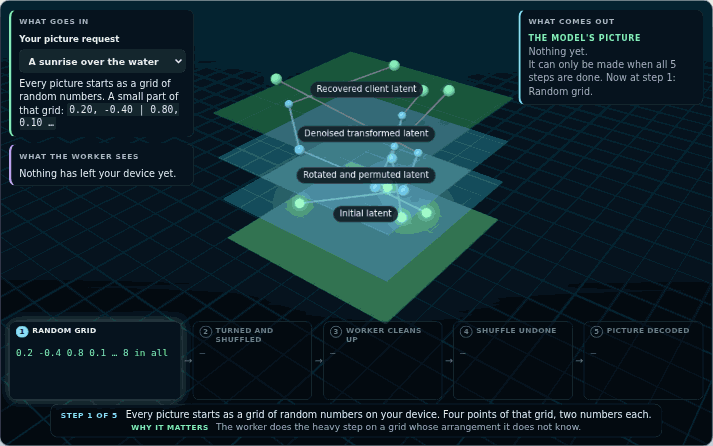<br>
<b>Making a picture</b><br>
A picture is produced step by step from numbers the worker only sees in disguise. The cards along the bottom show the real values of each step; the answer is written only after the last one.<br>
<sub>From <code>/laboratory#diffusion</code></sub>
</td>
</tr>
<tr>
<td width="50%" valign="top">
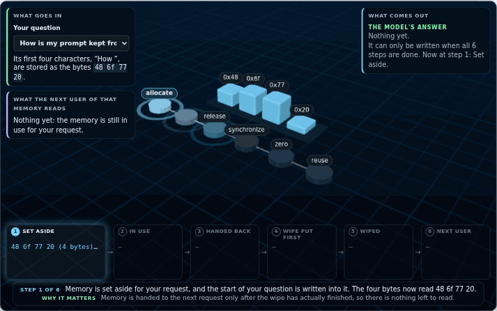<br>
<b>Wiping memory afterwards</b><br>
Memory is wiped, and the wipe confirmed finished, before it is handed to anyone else. The cards along the bottom show the real values of each step; the answer is written only after the last one.<br>
<sub>From <code>/laboratory#memory</code></sub>
</td>
<td width="50%"></td>
</tr>
</table>

### Every control of every laboratory

The same laboratories with their controls underneath. Every step card is pressed first, then every control. A yellow outline marks the control being used; the 3D scene is held still so that only the control's effect changes the picture, and the text between the stage and the controls is left out of the frame.

<table>
<tr>
<td width="50%" valign="top">
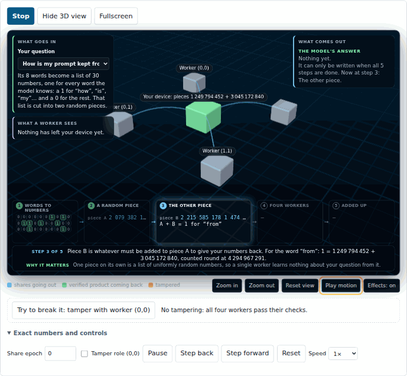<br>
<b>Splitting your question: every control</b><br>
Each control is changed in turn and put back.<br>
<sub>Controls used: Pause motion · Step 1: Words to numbers · Step 2: A random piece · Step 3: The other piece · Step 4: Four workers · Step 5: Added up · Share epoch · Tamper role (0,0) · Step forward · Step back · Reset · Play · Pause · Speed: 0.5× · Speed: 2× · Speed: 4× · Speed: 1× · Try to break it: tamper with worker (0,0) · Watch · Stop · Hide 3D view · Show 3D view</sub><br>
<sub>From <code>/laboratory#share-grid</code></sub>
</td>
<td width="50%" valign="top">
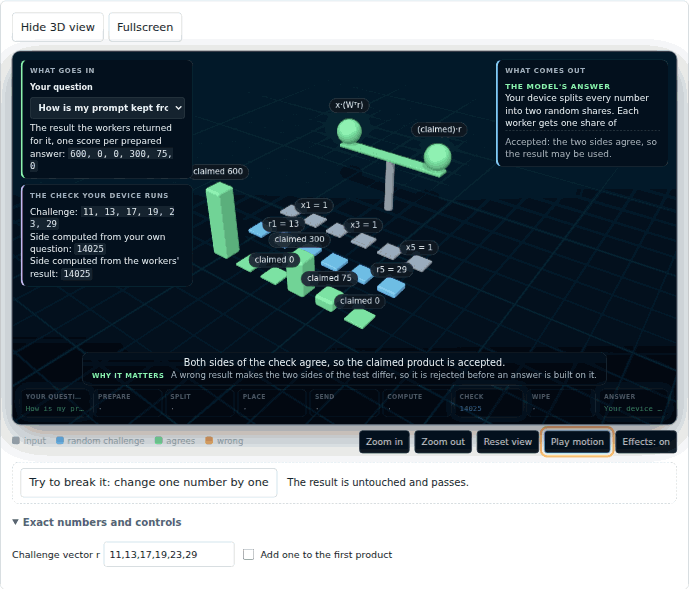<br>
<b>Catching a wrong answer: every control</b><br>
Each control is changed in turn and put back.<br>
<sub>Controls used: Pause motion · Step 1: The workers' result · Step 2: A challenge · Step 3: Side from the result · Step 4: Side from your question · Step 5: They match · Challenge vector r · Add one to the first product · Step forward · Step back · Reset · Play · Pause · Speed: 0.5× · Speed: 2× · Speed: 4× · Speed: 1× · Try to break it: change one number by one · Watch · Stop · Hide 3D view · Show 3D view</sub><br>
<sub>From <code>/laboratory#freivalds</code></sub>
</td>
</tr>
<tr>
<td width="50%" valign="top">
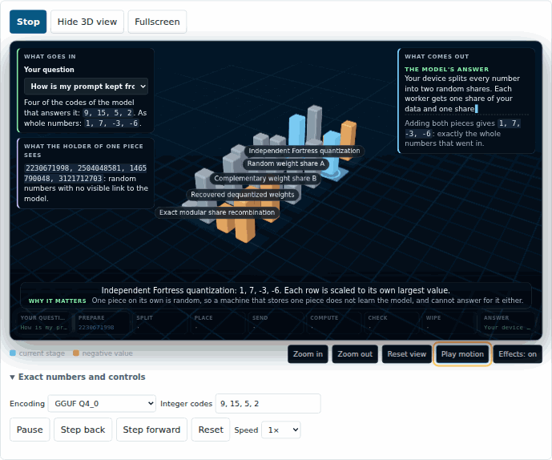<br>
<b>Storing the model in pieces: every control</b><br>
Each control is changed in turn and put back.<br>
<sub>Controls used: Pause motion · Step 1: Stored codes · Step 2: Decoded · Step 3: Whole numbers · Step 4: A random piece · Step 5: The other piece · Step 6: Added back · Encoding: EXL2 mixed widths · Encoding: EXL3 procedural 3INST · Encoding: GGUF Q4_0 · Integer codes · Step forward · Step back · Reset · Play · Pause · Speed: 0.5× · Speed: 2× · Speed: 4× · Speed: 1× · Watch · Stop · Hide 3D view · Show 3D view</sub><br>
<sub>From <code>/laboratory#quantized-formats</code></sub>
</td>
<td width="50%" valign="top">
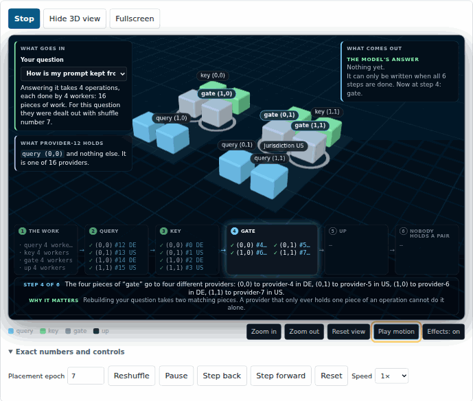<br>
<b>Deciding who gets which piece: every control</b><br>
Each control is changed in turn and put back.<br>
<sub>Controls used: Pause motion · Step 1: The work · Step 2: query · Step 3: key · Step 4: gate · Step 5: up · Step 6: Nobody holds a pair · Placement epoch · Reshuffle · Step forward · Step back · Reset · Play · Pause · Speed: 0.5× · Speed: 2× · Speed: 4× · Speed: 1× · Watch · Stop · Hide 3D view · Show 3D view</sub><br>
<sub>From <code>/laboratory#placement</code></sub>
</td>
</tr>
<tr>
<td width="50%" valign="top">
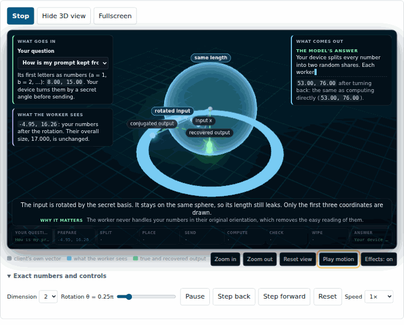<br>
<b>Disguising the numbers: every control</b><br>
Each control is changed in turn and put back.<br>
<sub>Controls used: Pause motion · Step 1: Your numbers · Step 2: Turned in secret · Step 3: Worker computes · Step 4: Turned back · Step 5: Same as direct · Dimension: 3 · Dimension: 4 · Dimension: 2 · Rotation θ · Step forward · Step back · Reset · Play · Pause · Speed: 0.5× · Speed: 2× · Speed: 4× · Speed: 1× · Watch · Stop · Hide 3D view · Show 3D view</sub><br>
<sub>From <code>/laboratory#conjugation</code></sub>
</td>
<td width="50%" valign="top">
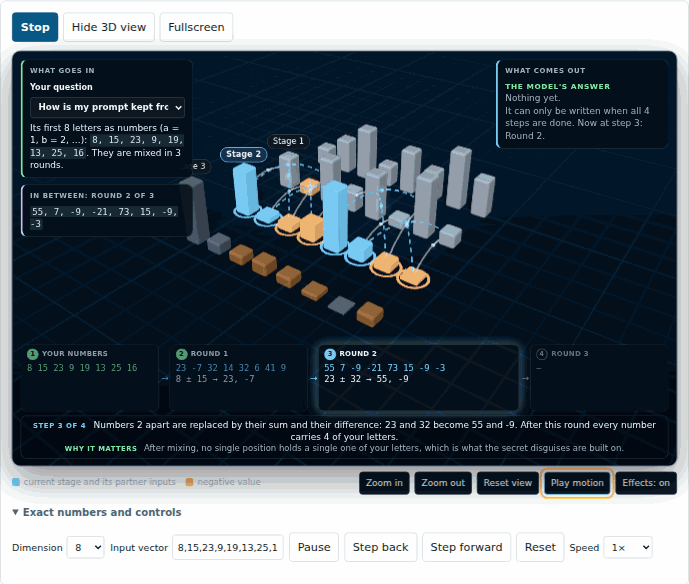<br>
<b>Mixing the numbers quickly: every control</b><br>
Each control is changed in turn and put back.<br>
<sub>Controls used: Pause motion · Step 1: Your numbers · Step 2: Round 1 · Step 3: Round 2 · Step 4: Round 3 · Dimension: 4 · Dimension: 16 · Dimension: 8 · Input vector · Step forward · Step back · Reset · Play · Pause · Speed: 0.5× · Speed: 2× · Speed: 4× · Speed: 1× · Watch · Stop · Hide 3D view · Show 3D view</sub><br>
<sub>From <code>/laboratory#fwht</code></sub>
</td>
</tr>
<tr>
<td width="50%" valign="top">
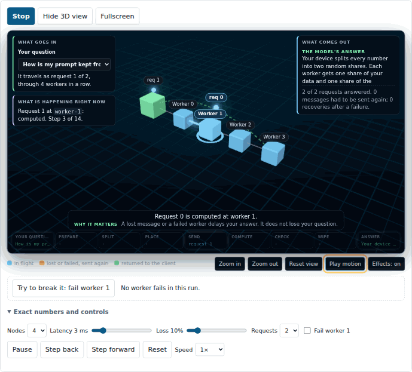<br>
<b>Getting your answer when a worker fails: every control</b><br>
Each control is changed in turn and put back.<br>
<sub>Controls used: Pause motion · Step 1: Sealed and sent · Step 2: Through the workers · Step 3: Back on your device · Step 4: The other requests · Nodes: 2 · Nodes: 3 · Nodes: 5 · Nodes: 6 · Nodes: 8 · Nodes: 4 · Latency · Loss · Requests: 1 · Requests: 4 · Requests: 8 · Requests: 2 · Fail worker · Step forward · Step back · Reset · Play · Pause · Speed: 0.5× · Speed: 2× · Speed: 4× · Speed: 1× · Try to break it: fail worker 1 · Stop · Watch · Hide 3D view · Show 3D view</sub><br>
<sub>From <code>/laboratory#pipeline</code></sub>
</td>
<td width="50%" valign="top">
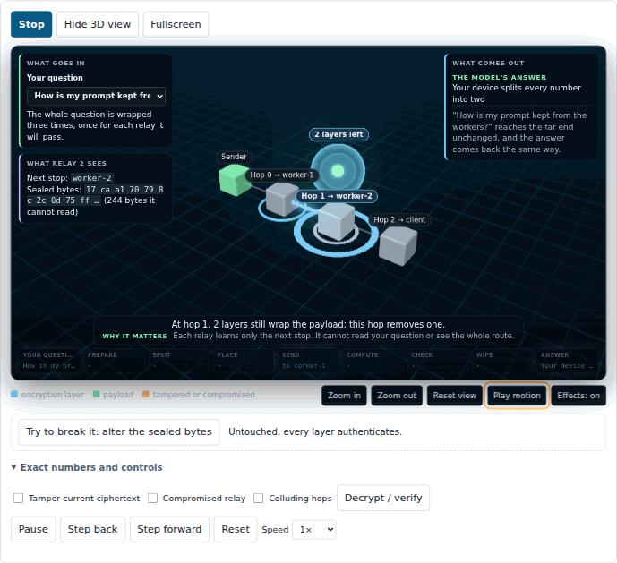<br>
<b>Hiding the route: every control</b><br>
Each control is changed in turn and put back.<br>
<sub>Controls used: Pause motion · Step 1: Readable · Step 2: Sealed three times · Step 3: Relay 1 · Step 4: Relay 2 · Step 5: Relay 3 · Step 6: Readable again · Alter the packet on its way to relay · Compromised relay · Colluding hops · Decrypt / verify · Step forward · Step back · Reset · Play · Pause · Speed: 0.5× · Speed: 2× · Speed: 4× · Speed: 1× · Try to break it: alter the sealed bytes · Watch · Stop · Hide 3D view · Show 3D view</sub><br>
<sub>From <code>/laboratory#onion</code></sub>
</td>
</tr>
<tr>
<td width="50%" valign="top">
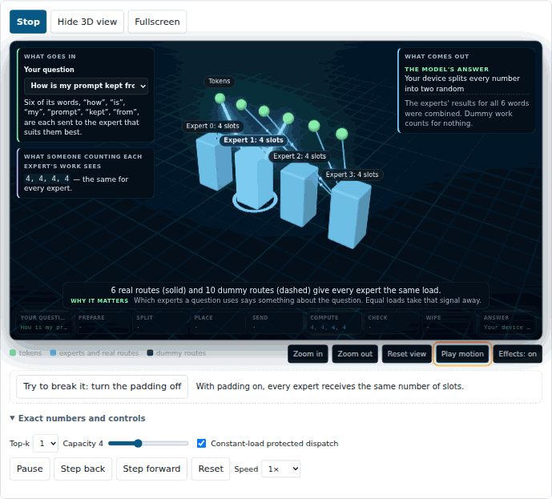<br>
<b>Hiding which experts were used: every control</b><br>
Each control is changed in turn and put back.<br>
<sub>Controls used: Pause motion · Step 1: Six words · Step 2: Router scores · Step 3: Real work · Step 4: Dummy work added · Step 5: Results combined · Top-k: 2 · Top-k: 3 · Top-k: 1 · Capacity · Constant-load protected dispatch · Step forward · Step back · Reset · Play · Pause · Speed: 0.5× · Speed: 2× · Speed: 4× · Speed: 1× · Try to break it: turn the padding off · Watch · Stop · Hide 3D view · Show 3D view</sub><br>
<sub>From <code>/laboratory#moe</code></sub>
</td>
<td width="50%" valign="top">
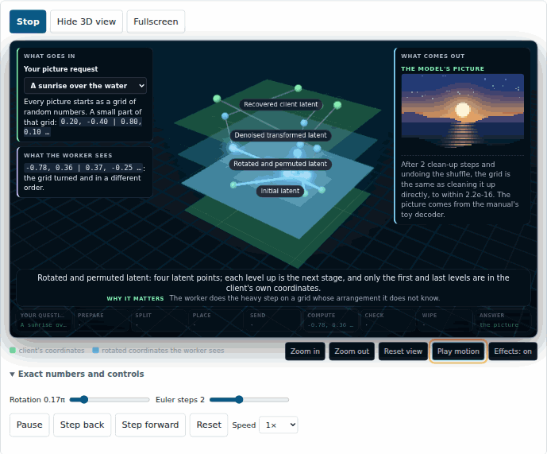<br>
<b>Making a picture: every control</b><br>
Each control is changed in turn and put back.<br>
<sub>Controls used: Pause motion · Step 1: Random grid · Step 2: Turned and shuffled · Step 3: Worker cleans up · Step 4: Shuffle undone · Step 5: Picture decoded · Rotation · Euler steps · Step forward · Step back · Reset · Play · Pause · Speed: 0.5× · Speed: 2× · Speed: 4× · Speed: 1× · Watch · Stop · Hide 3D view · Show 3D view</sub><br>
<sub>From <code>/laboratory#diffusion</code></sub>
</td>
</tr>
<tr>
<td width="50%" valign="top">
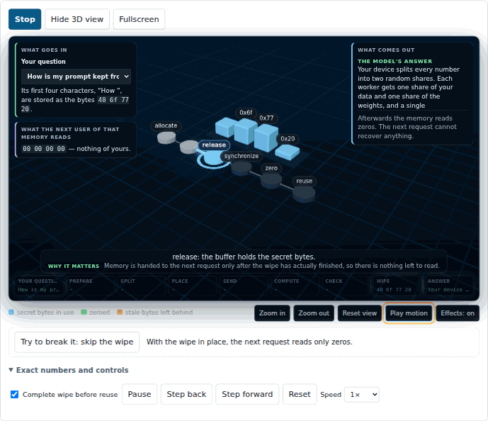<br>
<b>Wiping memory afterwards: every control</b><br>
Each control is changed in turn and put back.<br>
<sub>Controls used: Pause motion · Step 1: Set aside · Step 2: In use · Step 3: Handed back · Step 4: Wipe put first · Step 5: Wiped · Step 6: Next user · Complete wipe before reuse · Step forward · Step back · Reset · Play · Pause · Speed: 0.5× · Speed: 2× · Speed: 4× · Speed: 1× · Try to break it: skip the wipe · Watch · Stop · Hide 3D view · Show 3D view</sub><br>
<sub>From <code>/laboratory#memory</code></sub>
</td>
<td width="50%"></td>
</tr>
</table>

### The protection tour

The protection as seven layers around the data, one at a time.

<table>
<tr>
<td width="50%" valign="top">
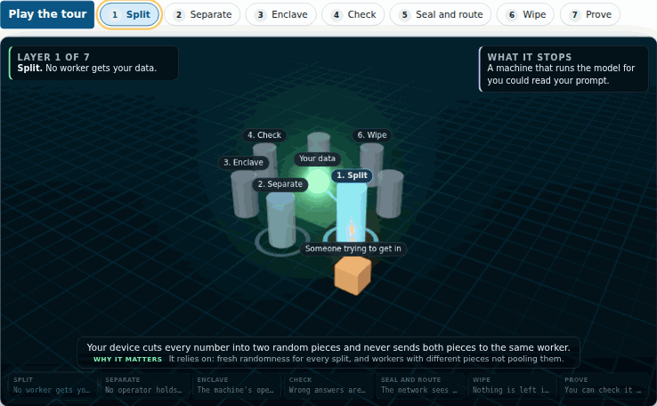<br>
<b>Seven layers, one at a time</b><br>
Split, Separate, Enclave, Check, Seal and route, Wipe, Prove: each with its guard post lit around the data.<br>
<sub>From <code>/protection</code></sub>
</td>
<td width="50%"></td>
</tr>
</table>

### Chapter diagrams

The schematic drawings of chapters 5, 7 and 9, stepped through with the real values of the chosen question.

<table>
<tr>
<td width="50%" valign="top">
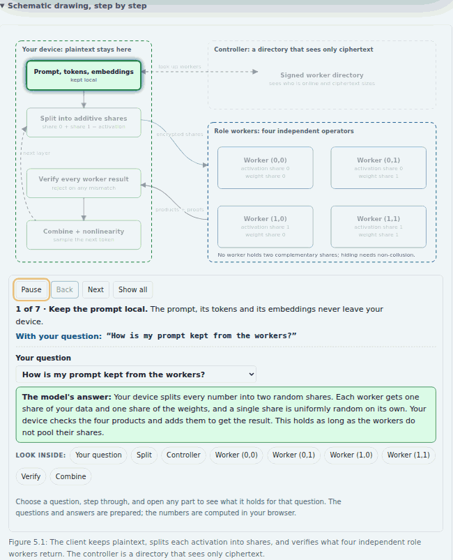<br>
<b>System architecture</b><br>
From the question on your device to the combined answer, part by part.<br>
<sub>From <code>/05-system-architecture</code></sub>
</td>
<td width="50%" valign="top">
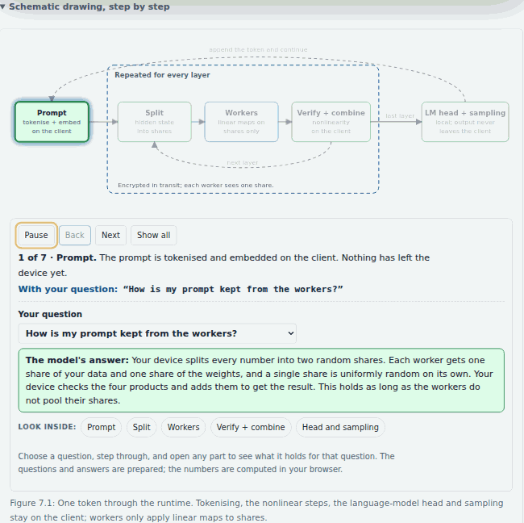<br>
<b>Runtime loop</b><br>
One token round the loop: split, compute, check, combine, next layer, next token.<br>
<sub>From <code>/07-inference-runtime</code></sub>
</td>
</tr>
<tr>
<td width="50%" valign="top">
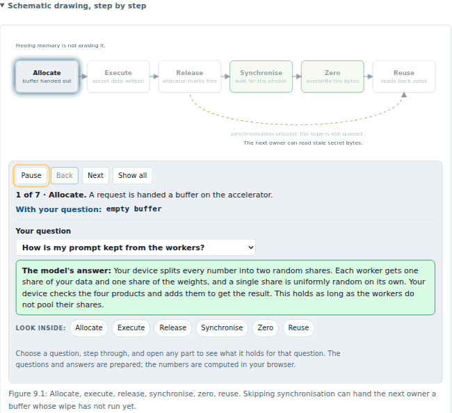<br>
<b>Memory life cycle</b><br>
Allocate, execute, release, synchronise, zero, reuse, and what goes wrong if a step is skipped.<br>
<sub>From <code>/09-memory-security</code></sub>
</td>
<td width="50%"></td>
</tr>
</table>

### Settings

The choices a reader can make on any page.

<table>
<tr>
<td width="50%" valign="top">
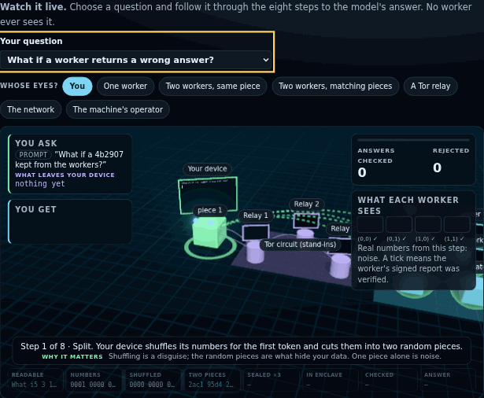<br>
<b>Your question</b><br>
Six prepared questions. The choice is shared by the chapters, the laboratories, the diagrams and the tour.<br>
<sub>From <code>/05-system-architecture</code></sub>
</td>
<td width="50%" valign="top">
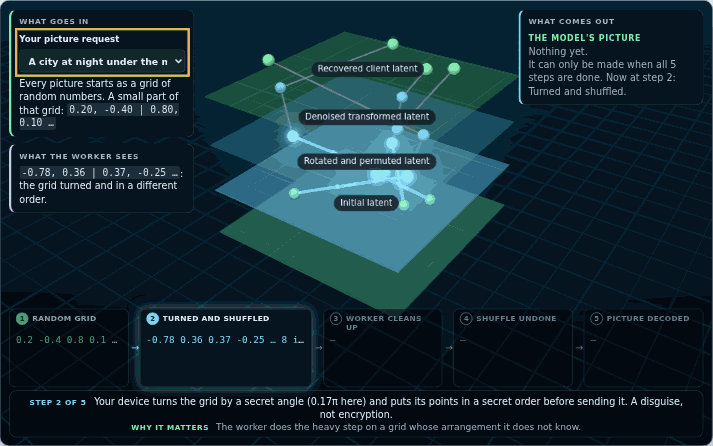<br>
<b>Your picture request</b><br>
Two prepared picture requests, used by the picture laboratory.<br>
<sub>From <code>/laboratory#diffusion</code></sub>
</td>
</tr>
<tr>
<td width="50%" valign="top">
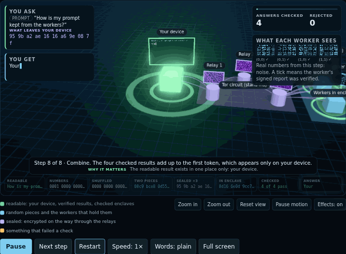<br>
<b>Plain or technical words</b><br>
Everyday wording, or the terms the chapters use.<br>
<sub>From <code>/show</code></sub>
</td>
<td width="50%" valign="top">
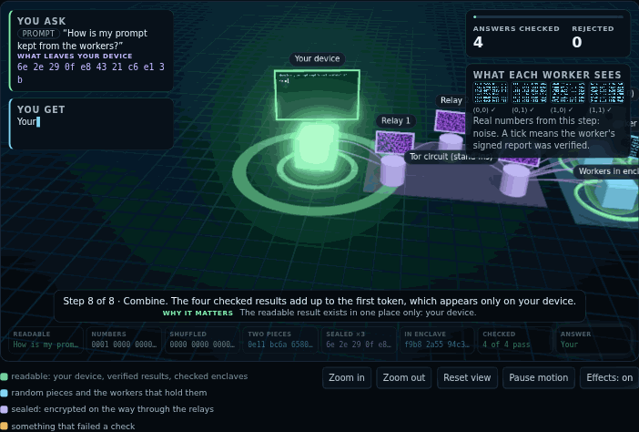<br>
<b>Glow effects: on, off, automatic</b><br>
Glow and shadows can be switched off; “auto” switches them off by itself on slow graphics hardware, as it does on the machine that made these recordings.<br>
<sub>From <code>/show</code></sub>
</td>
</tr>
<tr>
<td width="50%" valign="top">
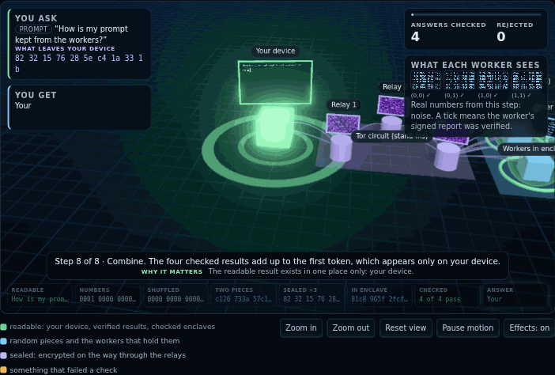<br>
<b>Pause motion</b><br>
The 3D view stands still on request (and always does for readers who ask their system for reduced motion).<br>
<sub>From <code>/show</code></sub>
</td>
<td width="50%" valign="top">
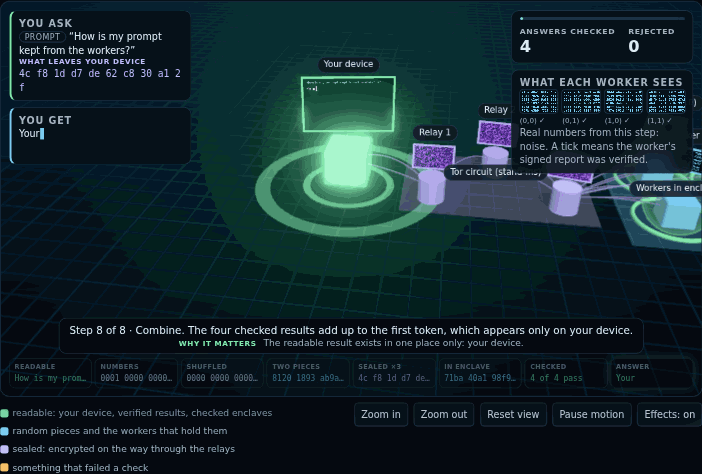<br>
<b>Turn, zoom and reset the 3D view</b><br>
Every 3D view can be dragged round, zoomed and reset.<br>
<sub>From <code>/show</code></sub>
</td>
</tr>
<tr>
<td width="50%" valign="top">
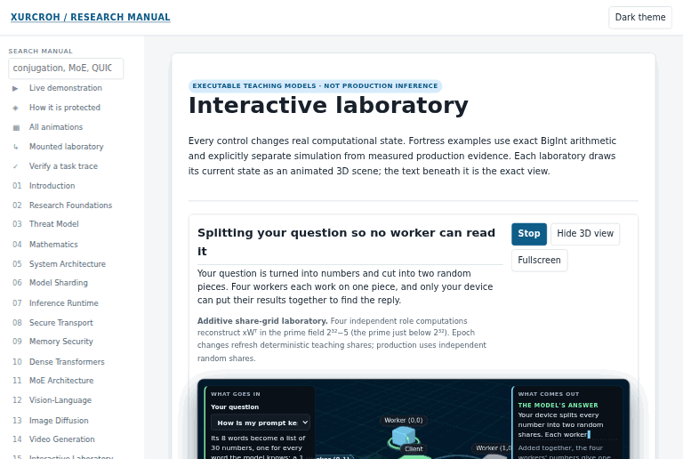<br>
<b>Light and dark theme</b><br>
The pages switch between a light and a dark theme; the stages are dark in both.<br>
<sub>From <code>/laboratory#share-grid</code></sub>
</td>
<td width="50%" valign="top">
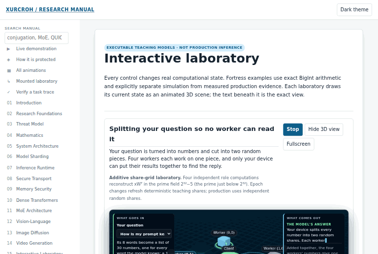<br>
<b>A laboratory filling the window</b><br>
Every laboratory has a Fullscreen button.<br>
<sub>From <code>/laboratory#share-grid</code></sub>
</td>
</tr>
</table>

<!-- animations:end -->

## Public Python API

```python
from Xurcroh import Xurcroh

client = Xurcroh(
    cluster=[{"name": "local", "endpoint": "local://cpu"}],
    model_path={"qwen-7b": "/models/qwen-7b"},
)

response = client.chat.completions.create(
    model="qwen-7b",
    messages=[{"role": "user", "content": "Hello!"}],
)
print(response.choices[0].message.content)
client.close()
```

Synchronous, asynchronous, streaming, multimodal, advanced cluster, and security configuration are documented in `docs/sdk.md`. GGUF, EXL2/GPTQ, and EXL3 checkpoints use the same Fortress API with automatic format detection and explicit semantic adapters; unknown graph semantics fail closed. A requested model must resolve to a real execution adapter; Xurcroh never returns generated-looking canned responses. Deployment and repeatable JSON benchmarks are documented in `docs/deployment.md` and `docs/benchmarking.md`.

## Protected multi-host quickstart

From a committed source checkout, SSH-reachable CUDA workers can be provisioned automatically with per-operation placement. The trusted client downloads the pinned checkpoint, compiles encrypted role artifacts, starts the workers, and tears them down when the context exits. This Gemma topology uses 20 workers with alternating geographic and CPU-vendor metadata:

```python
from Xurcroh import Xurcroh

workers = [
    {
        "name": f"gpu-{index}",
        "host": f"10.0.0.{10 + index}",
        "ssh": {"username": "ubuntu", "key_path": "~/.ssh/id_ed25519"},
        "provider": {
            "country": "us" if index % 2 else "de",
            "cpu_vendor": "amd" if index % 2 else "intel",
        },
    }
    for index in range(20)
]

with Xurcroh(
    cluster=workers,
    model_path={
        "gemma": {
            "path": "google/gemma-4-E2B-it",
            "revision": "4adf15748de9e1a0097b6274cee9c15836c41c37",
            "engine": "fortress",
            "allow_download": True,
        }
    },
) as client:
    response = client.chat.completions.create(
        model="gemma",
        messages=[{"role": "user", "content": "Hello!"}],
        max_tokens=128,
    )
    print(response.choices[0].message.content)
```

A runnable CLI version is available at `examples/managed_gemma.py`; supply each worker with repeated `--host` arguments and use `--datagram-tunnel` when direct UDP is unavailable. Use `--shares N` for per-operation `N × N` grids and provide exactly `5N²` hosts; the default is `--shares 2` with 20 hosts. Set `--countries` and `--cpu-vendors` to one value each or one per host to describe the actual infrastructure. Use a trusted gateway with sufficient host memory and disk for checkpoint compilation. `client.preflight()` reports measured checkpoint size and resource issues before inference. Official Gemma checkpoints completed physical multi-host validation on the frozen build documented in `docs/xurcroh-validation-report.md`; always deploy a pinned revision.

## Development

```bash
./scripts/bootstrap-python.sh
.venv/bin/pytest
```

The interactive research manual source is under `apps/web-manual/` and is independent of the production runtime. GPU topology estimates and outstanding hardware risks are in `docs/resources.md`.

## Security

Report vulnerabilities privately as described in `SECURITY.md`. Never commit credentials, private keys, checkpoints, raw prompts, generated shards, or sensitive runtime logs.
